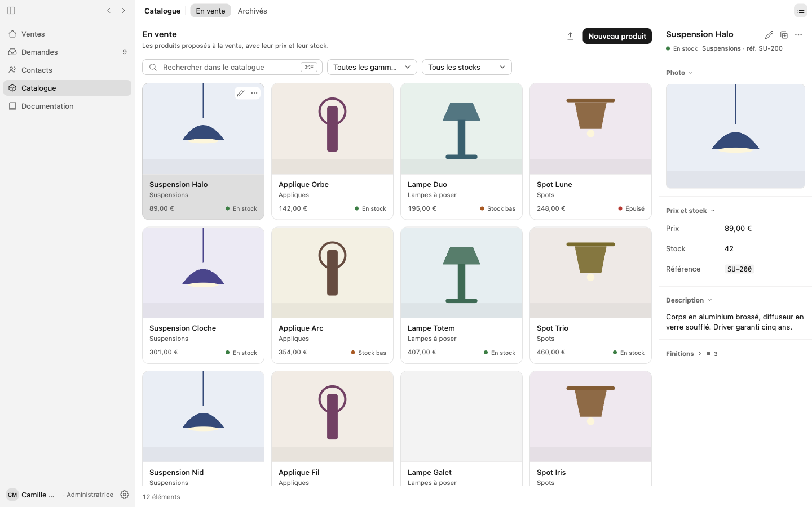

# Recette : Catalogue
Statut : validé (2026-11-26, par délégation de l'utilisateur) — Version : depuis 1.21.0 ; zones expliquées depuis 1.21.1
Décision : D-410. Stories : « Recettes/Catalogue ». Captures : [clair](Catalog-clair.png), [sombre](Catalog-sombre.png).



## Quand la prendre
- Des éléments qu'on reconnaît à leur image : produits, photos, modèles, documents avec leur aperçu.
- On les parcourt en vignettes, on filtre, on ouvre la fiche à côté.
- Pas pour des éléments qu'on compare propriété par propriété : recette « Liste et fiche » (tableau).

## Zones
Une zone de l'écran, une responsabilité (D-404, D-417) : chaque zone ci-dessous dit ce qu'elle porte dans cette page, avec quel composant, quand la prendre et pourquoi.

| Zone | Sa responsabilité ici | Composant | Quand, pourquoi |
|---|---|---|---|
| Onglet fixe « En vente » | Les produits proposés, en vignettes, avec la recherche et les filtres | `ListPage` `layout="grid"`, `item`, `thumbnail` | L'usage principal. On reconnaît un produit à son image : les vignettes prennent toute la page. |
| Onglet fixe « Archivés » | Les produits retirés de la vente | `ListPage` | Un autre contexte : il n'encombre pas le catalogue. |
| Panneau de droite | La vue détail du produit sélectionné : photo, prix et stock, description, finitions | `Drawer` déclaratif, `ImageThumbnail`, `Table density="compact"` | Quand une vignette est choisie. La grille reste visible ; un autre choix change la fiche. |
| Barre du haut, en-tête du gabarit | Les actions du catalogue : « Nouveau produit », « Importer des photos » | `ActionBar` zone `header` | Une action est toujours au même endroit. Quand le catalogue est vide, l'action principale revient dans son état vide. |
| Toute la page | Le dépôt de photos | `onDropFiles` de `ListPage` | Quand l'app reçoit des fichiers glissés : on dépose sur la page, sans viser un cadre. |
| Sous-entrées de la sidebar (facultatives) | Les gammes que l'utilisateur suit | `children` de `Sidebar.Item` (sous-pages, D-056) | Quand il revient toujours aux mêmes gammes : chacune devient un lieu, et la page reste une seule, filtrée. |

## Actions
| Action | Où | Forme |
|---|---|---|
| Nouveau produit | En-tête de `ListPage` ; état vide | Action `primary` |
| Importer des photos | En-tête de `ListPage` | Icône |
| Modifier, Dupliquer | Vignette (au survol) ; en-tête du panneau | Icônes |
| Archiver | Vignette ; en-tête du panneau | Dans « … » |

## États
| État | Rendu |
|---|---|
| Catalogue vide | `EmptyState` de `ListPage` : « Aucun produit », « Créez un produit, ou déposez ses photos sur la page. », « Nouveau produit ». |
| Premier chargement | Vignettes en squelette (`rows` vaut `undefined`). |
| Aucun résultat, erreur | Rendus par `ListPage`. |
| Produit sans photo | Aperçu vide ; pour un document, l'icône et le type de fichier (`thumbnail.type`). |
| Aucune sélection | `emptyMessage` : « Sélectionnez un produit pour voir sa fiche. » |
| Photos au-dessus de la page | Cadre « Déposez les photos pour créer les produits ». |

## Comportement
- Vignettes de 200 px au moins, autant par ligne que la place le permet ; aperçu 4:3, image recadrée par le haut (D-414).
- Un clic ou les flèches (dans les deux sens) sélectionnent ; la fiche suit dans le panneau. Entrée ouvre.
- Le stock se lit sur chaque vignette : statut (`Badge`) « En stock », « Stock bas », « Épuisé ».
- Dans la fiche, la photo s'agrandit d'un clic (`ImageThumbnail`).

## Squelette
```tsx
<ListPage title="En vente" rows={produits} columns={COLONNES} layout="grid"
  item={{ title: "nom", subtitle: "gamme", meta: "prix", status: "etat" }}
  thumbnail={(p) => (p.photo ? { src: p.photo } : undefined)}
  filters={[GAMME, STOCK]} actions={[nouveau, importerPhotos]} rowActions={(p) => [modifier(p), archiver(p)]}
  selectedId={choisi} onSelect={(p) => choisir(p?.id ?? null)} onDropFiles={creerDepuisPhotos}
  empty={{ title: "Aucun produit", description: "Créez un produit, ou déposez ses photos sur la page." }} />

<Drawer header={{ title: p.nom, subtitle: `${p.gamme} · réf. ${p.reference}`, status: STOCK[p.etat], actions: [...] }}
  sections={[{ id: "photo", title: "Photo", content: <ImageThumbnail alt={p.nom} src={p.photo} /> },
    { id: "vente", title: "Prix et stock", fields: [{ label: "Prix", value: p.prix, type: "money" }, …] },
    { id: "finitions", title: "Finitions", defaultCollapsed: true, content: <Table density="compact" … /> }]} />
```
Pour des documents : `thumbnail={(d) => ({ src: d.apercu, type: "pdf" })}` ; sans aperçu, l'icône et « PDF » le remplacent.

## À éviter
- Un mur de `Card` faites à la main : la grille de `ListPage` dessine les vignettes, leurs états et leur clavier.
- Une bascule liste / grille dans la page : la recette choisit la grille.
- Des images de tailles libres : l'aperçu est 4:3, recadré.

## Décisions
D-021, D-111, D-383, D-404, D-410, D-414, D-416, D-417.
