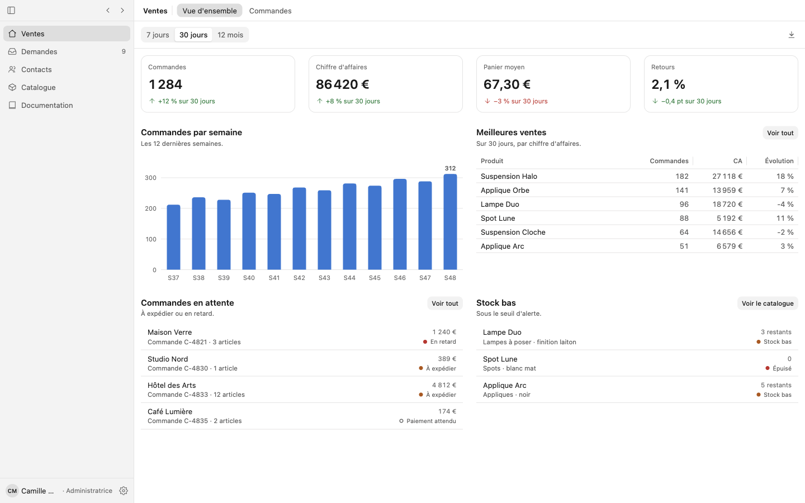

# Recette : Tableau de bord
Statut : validé (2026-11-26, par délégation de l'utilisateur) — Version : depuis 1.21.0
Décision : D-407. Stories : « Recettes/Tableau de bord ». Captures : [clair](Dashboard-clair.png), [sombre](Dashboard-sombre.png).



## Quand la prendre
- Une vue d'ensemble d'une activité : quelques chiffres clés, une évolution, ce qui demande une action.
- Tout tient sur un écran de bureau (1440 × 900), sans défiler.
- Pas pour une collection à parcourir : `ListPage`. Pas pour un rapport à lire : `DetailPage`.

## Zones
| Zone | Ce qui y va | Composant |
|---|---|---|
| Barre du haut, vues | « Vue d'ensemble », puis les listes détaillées (« Commandes ») | vues de l'`AppShell` (D-021) |
| `main`, barre d'outils | La période (et un filtre au plus) à gauche ; « Exporter » à droite | `Page` `toolbar` (`SegmentedControl` ou `Select`), `actions` zone `toolbar` |
| `main`, rangée 1 | Quatre chiffres clés au plus | `PageGrid columns={4}`, `Card variant="metric"` |
| `main`, rangée 2 | L'évolution (graphique) et le détail (tableau), côte à côte | `PageGrid columns={2}`, `PageSection` ; graphique de l'app ; `Table density="compact"` |
| `main`, rangée 3 (facultative) | Ce qui attend une action : listes courtes | `PageGrid columns={2}`, `PageSection`, `List` |
| Panneau de détail | Facultatif : l'élément choisi dans un tableau | `Drawer` déclaratif |

Toute la largeur : jamais `width="text"`. Trois rangées au plus.

## Le graphique
Socle ne dessine pas de graphique : l'app prend une librairie et lui passe les tokens. Une série : `--chart-1` ; plusieurs : `--chart-1` à `--chart-8`, dans cet ordre. Grille et axes en `--line` et `--fg-3`, textes en `--fg-2` et `--fg-3`. Barres de 24 px au plus, bout arrondi de 4 px. Une étiquette directe sur la valeur qui compte, une info-bulle par barre ou par point, un nom accessible qui résume la série. Pas de légende pour une seule série : le titre de la section la nomme.

## Actions
| Action | Où | Forme |
|---|---|---|
| Changer la période | Barre d'outils de `Page` | `SegmentedControl` (2 à 4 périodes), appliqué tout de suite |
| Exporter | Barre d'outils de `Page`, à droite | Icône |
| Ouvrir le détail d'un chiffre | Toute la carte | `Card` `onPress` : la vue qui liste ce que le chiffre compte |
| Voir tout | Titre de chaque section | Action `primary` de la zone `section` (bouton secondaire `sm`) |

Un chiffre sans action n'a pas sa place (D-361).

## États
| État | Rendu |
|---|---|
| Premier chargement | `Page state="loading"` : la barre reste, des squelettes à la place des blocs. |
| Échec de la page | `Page state="error"` et `onRetry`. |
| Échec d'un bloc | `PageSection state="error"` et `onRetry` : les autres blocs restent. |
| Période sans données | Cartes à « 0 » ou « — », sans évolution ; sections en `empty` avec l'action qui élargit la période. |
| Chargement d'un bloc | `PageSection state="loading"`. |

## Comportement
- La période s'applique tout de suite ; elle est gardée par la page.
- Une carte mène à la vue qui liste ce qu'elle compte, filtrée (onglet de la barre du haut).
- Les blocs d'une rangée ont la même hauteur ; sous 1032 px de large, quatre cartes passent sur deux lignes de deux (`PageGrid`, D-403).

## Squelette
```tsx
<Page toolbar={<SegmentedControl label="Période" options={PERIODES} value={periode} onChange={setPeriode} />}
  actions={[{ id: "exporter", label: "Exporter", icon: <Download />, onPress: exporter }]}
  state={etat} onRetry={recharger}>
  <PageGrid columns={4}>
    <Card variant="metric" label="Commandes" value={<FormattedValue value={1284} type="number" />}
      delta={{ text: "+12 % sur 30 jours", tone: "positive" }} onPress={() => ouvrir("commandes")} />
    {/* trois autres cartes */}
  </PageGrid>
  <PageGrid columns={2}>
    <PageSection title="Commandes par semaine" description="Les 12 dernières semaines.">{graphique}</PageSection>
    <PageSection title="Meilleures ventes" actions={[voirTout]}><Table density="compact" … /></PageSection>
  </PageGrid>
  <PageGrid columns={2}>
    <PageSection title="Commandes en attente"><List … /></PageSection>
    <PageSection title="Stock bas"><List … /></PageSection>
  </PageGrid>
</Page>
```

## À éviter
- Une pile de sections dans une colonne de 760 px (D-404).
- Plus de quatre chiffres clés, ou un mur de cartes identiques.
- Un chiffre sans action, une carte décorative.
- Deux axes sur un même graphique ; une couleur d'état pour une série.
- Une recherche ou des filtres de liste dans la barre d'outils : la liste a sa vue.

## Décisions
D-021, D-111, D-213, D-216, D-361, D-403, D-404, D-407.
