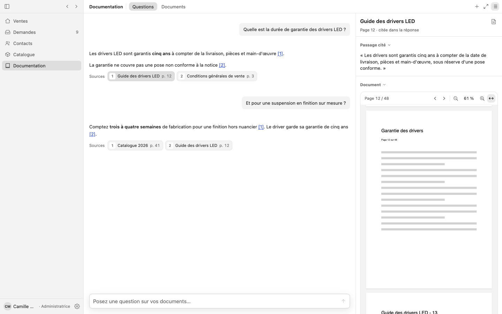

# Recette : Base de connaissances
Statut : validé (2026-11-26, par délégation de l'utilisateur) — Version : depuis 1.21.0
Décision : D-406. Stories : « Recettes/Base de connaissances ». Captures : [clair](KnowledgeBase-clair.png), [sombre](KnowledgeBase-sombre.png).



## Quand la prendre
- Des documents (PDF) où l'on cherche des réponses : on pose une question en langage courant, la réponse cite ses sources, une source ouvre le document à la page citée.
- Pas pour une simple liste de fichiers : recette « Liste et fiche », ou « Catalogue » en vignettes.
- Pas pour une conversation avec un agent sans documents : `ChatPage` seule.

## Zones
| Zone | Ce qui y va | Composant |
|---|---|---|
| Barre du haut, vues | « Questions », « Documents » | vues de l'`AppShell` (D-021) |
| Barre du haut, actions | « Nouvelle conversation » (vue Questions) | `ActionBar` zone `topbar` |
| `main`, vue Questions | Les questions et les réponses, la saisie en bas | `ChatPage`, `ChatTranscript`, `ChatMessage`, `Markdown`, `SourceList`, `ChatComposer` |
| `main`, vue Documents | Les documents et leur état d'indexation, la recherche, le filtre d'état | `ListPage` en tableau |
| Panneau de détail, vue Questions | La source ouverte : passage cité, puis le document à la page citée | `Drawer` déclaratif, `DocumentViewer` avec `page` |
| Panneau de détail, vue Documents | Le document sélectionné : propriétés, aperçu, actions | `Drawer` déclaratif, `DocumentViewer` |
| Toute la page | Dépôt de PDF, dans les deux vues | `onDropFiles` de `ChatPage` et de `ListPage` |

Le panneau a la largeur d'un formulaire (`detailWidth="form"`) et s'agrandit (`detailExpandable`) : un PDF s'y lit.

## Actions
| Action | Où | Forme |
|---|---|---|
| Ajouter des documents | En-tête de la vue Documents ; état vide de la vue Questions sans document | Action `primary` ; `Button` `primary` de l'`EmptyState` |
| Nouvelle conversation | Barre du haut, vue Questions | Icône |
| Ouvrir une source | Puce de `SourceList` ; lien `[n]` du texte | `onOpen` ; `onLinkPress` de `Markdown` |
| Voir dans les documents | En-tête du panneau (source) | Icône |
| Réindexer, Supprimer | Ligne du tableau ; en-tête du panneau (document) | Icône ; `danger` confirmé, dans « … » |

## États
| État | Rendu |
|---|---|
| Aucun document | Vue Questions : `EmptyState` « Aucun document », phrase, bouton « Ajouter des documents » ; saisie inactive. Vue Documents : état vide de `ListPage`. |
| Aucune question | `EmptyState` « Posez une question à vos documents », phrase, trois questions d'exemple (`suggestions`). Un clic pose la question. |
| Recherche en cours | La question, puis `WorkStatus` « Recherche dans les documents » ; la saisie montre l'attente (`isRunning`). |
| Réponse | Texte en `Markdown`, sources dans `sources` de `ChatMessage` (`SourceList`). |
| Aucun passage pertinent | La réponse le dit, sans `SourceList`. |
| Échec de la réponse | `Alert` `danger` dans `alerts` de `ChatPage`, avec « Réessayer » ; la question est gardée. |
| Indexation | Colonne d'état : « En attente » (`neutral`), « Indexation en cours » (`pending`), « Indexé » (`success`), « Échec » (`danger`, avec « Réindexer »). |
| Chargement, erreur de la liste | Rendus par `ListPage` (`rows` vaut `undefined`, `hasError`, `onRetry`). |
| Panneau sans source | « Cliquez sur une source pour ouvrir le document à la bonne page. » (`emptyMessage`). |
| Document illisible | État d'erreur de `DocumentViewer`. |

## Comportement
- Un clic sur une source ouvre le panneau (`isDetailOpen`) : en-tête au nom du document, « Page 12 · citée dans la réponse », section « Passage cité », puis le PDF à la page citée (`page`).
- La puce de la source ouverte est marquée (`currentId`) ; une autre puce change de document et de page.
- Le texte cite chaque source par son numéro, en lien : `[[1]](#source-1)`. `onLinkPress` ouvre la même source que la puce.
- Un PDF déposé n'importe où entre dans la liste, « En attente », puis « Indexation en cours ».
- La vue Documents garde sa recherche et son filtre ; la sélection ouvre le document dans le panneau.

## Squelette
```tsx
<AppShell pageTitle="Documentation" views={VUES} activeView="questions"
  actions={<ActionBar zone="topbar" actions={[nouvelleConversation]} />}
  detail={<Drawer header={…} sections={[{ id: "passage", … }, { id: "document", content: <DocumentViewer page={source.page} … /> }]} />}
  detailWidth="form" detailExpandable isDetailOpen={sourceOuverte} onDetailOpenChange={…}>
  <ChatPage onDropFiles={ajouter} alerts={erreur && <Alert tone="danger" …/>}
    composer={<ChatComposer placeholder="Posez une question sur vos documents…" onSubmit={demander} isRunning={enCours} />}>
    <ChatTranscript empty={<EmptyState title="Posez une question à vos documents" suggestions={EXEMPLES} />}>
      <ChatMessage role="user">{question}</ChatMessage>
      <ChatMessage role="assistant" sources={<SourceList sources={sources} currentId={ouverte} onOpen={ouvrir} />}>
        <Markdown onLinkPress={ouvrirParNumero}>{reponse}</Markdown>
      </ChatMessage>
    </ChatTranscript>
  </ChatPage>
</AppShell>
```
Une app dont la coquille est fournie garde la même répartition : chaque vue est un onglet, le panneau est le panneau de détail de la page, les actions de la barre du haut passent par sa coquille.

## À éviter
- Empiler la question, les exemples, une zone de dépôt, la liste des documents et la réponse dans une colonne (D-404).
- Une zone de dépôt dessinée dans la page : le dépôt prend toute la page.
- Les sources en `List` ou en liens sous la réponse : `SourceList`.
- Ouvrir le PDF hors de l'app, ou à sa première page : `DocumentViewer` avec `page`.
- Les documents dans la vue Questions : ils ont leur vue.

## Décisions
D-021, D-111, D-382, D-404, D-406, D-411, D-412, D-413, D-416.
