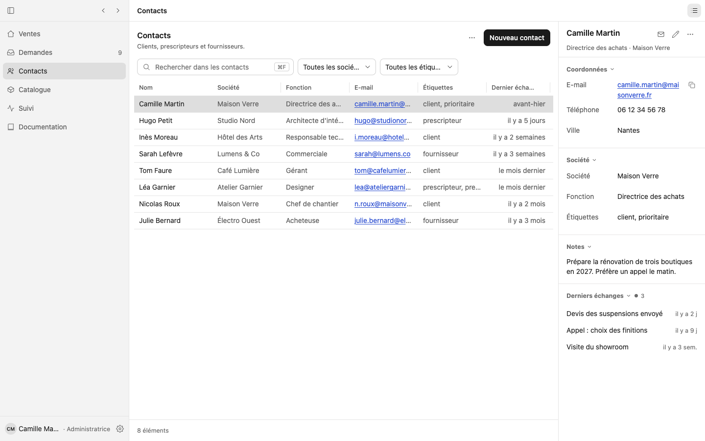

# Recette : Liste et fiche
Statut : validé (2026-11-26, par délégation de l'utilisateur) — Version : depuis 1.21.0 ; zones expliquées depuis 1.21.1
Décision : D-409. Stories : « Recettes/Liste et fiche ». Captures : [clair](ListDetail-clair.png), [sombre](ListDetail-sombre.png).



## Quand la prendre
- Une collection d'éléments de même nature qu'on cherche, filtre, compare et modifie : contacts, factures, fournisseurs, tâches.
- La fiche de l'élément choisi se lit à côté de la liste, sans la quitter.
- Pas pour une file qu'on vide : recette « File de tri ». Pas pour des éléments qu'on reconnaît à leur image : recette « Catalogue ».

## Zones
Une zone de l'écran, une responsabilité (D-404, D-417) : chaque zone ci-dessous dit ce qu'elle porte dans cette page, avec quel composant, quand la prendre et pourquoi.

| Zone | Sa responsabilité ici | Composant | Quand, pourquoi |
|---|---|---|---|
| Contenu | La collection : chercher, filtrer, comparer | `ListPage` en tableau | Toujours : c'est la tâche de la page. Elle prend toute la largeur. |
| Panneau de droite | La vue détail de l'élément sélectionné : sa fiche (coordonnées, propriétés, notes, derniers échanges) | `Drawer` déclaratif | Quand l'utilisateur choisit un élément. La fiche se lit à côté de la liste ; un autre choix change la fiche. |
| Barre du haut, en-tête du gabarit | Les actions de la collection : « Nouveau contact », « Importer un fichier » | `ActionBar` zone `header` | Une action est toujours au même endroit. Quand la liste est vide, l'action principale revient dans son état vide. |
| Fenêtre | Créer, modifier | formulaire court en `Modal` (six champs au plus) ; `FormPage` au-delà | Un geste court qui se termine : il passe devant la liste, puis la rend telle quelle. |
| Onglet ouvert (facultatif) | Un élément ouvert en entier | `DetailPage` dans une vue fermable | Quand l'élément se lit ou se traite en entier (un dossier, une facture). La liste reste intacte dans son onglet. |
| Onglets fixes (facultatifs) | Des contextes de la collection : « Clients », « Fournisseurs » | vues de la barre du haut | Quand l'utilisateur passe d'un contexte à l'autre. Sinon, un filtre suffit. |
| Sous-entrées de la sidebar (facultatives) | Des objets que l'utilisateur suit : un client, une société | `children` de `Sidebar.Item` (sous-pages, D-056) | Quand il revient toujours aux mêmes objets : l'objet devient un lieu, et la page reste une seule. |

## Actions
| Action | Où | Forme |
|---|---|---|
| Nouveau contact | En-tête de `ListPage` ; état vide | Action `primary` |
| Importer un fichier | En-tête de `ListPage` | Dans « … » |
| Écrire, Modifier | Ligne ; en-tête du panneau | Icônes |
| Copier une valeur | Ligne de propriété du panneau | `action` de type `icon` |
| Supprimer | Ligne ; en-tête du panneau | `danger`, dans « … », confirmé |

## États
| État | Rendu |
|---|---|
| Collection vide | `EmptyState` de `ListPage` : icône, « Aucun contact », phrase, « Nouveau contact ». |
| Aucun résultat | Rendu par `ListPage`, avec « Effacer la recherche ». |
| Chargement, erreur | `ListPage` (`rows` vaut `undefined`, `hasError`) ; `Drawer` (`isLoading`, `hasError`, `isNotFound`). |
| Aucune sélection | `emptyMessage` : « Sélectionnez un contact pour voir sa fiche. » |
| Section sans contenu | `empty` de la section : « Aucune note ». |

## Comportement
- Un clic ou les flèches sélectionnent ; la fiche suit la sélection dans le panneau.
- Double-clic ou Entrée : l'élément s'ouvre en entier dans une vue fermable (`DetailPage`), si l'app en a besoin.
- Les valeurs sont typées : `email` (lien), `tags` (étiquettes), `relative` (« il y a 2 jours ») ; le gabarit les met en forme.
- Après une écriture dans le panneau, la liste se recharge.

## Squelette
```tsx
<ListPage title="Contacts" rows={contacts} columns={COLONNES} filters={[SOCIETE, ETIQUETTE]}
  actions={[{ id: "nouveau", label: "Nouveau contact", icon: <Plus />, primary: true, onPress: creer }, importer]}
  rowActions={(c) => [ecrire(c), supprimer(c)]} selectedId={choisi} onSelect={(c) => choisir(c?.id ?? null)}
  empty={{ title: "Aucun contact", description: "Ajoutez vos clients et vos fournisseurs, ou importez un fichier." }} />

<Drawer header={{ title: c.nom, subtitle: `${c.fonction} · ${c.societe}`, actions: [ecrire, modifier, supprimer] }}
  sections={[{ id: "coordonnees", title: "Coordonnées", fields: [{ label: "E-mail", value: c.email, type: "email" }, …] },
    { id: "societe", … }, { id: "notes", title: "Notes", content: c.notes, empty: "Aucune note" },
    { id: "echanges", title: "Derniers échanges", summary: "3", content: <List dividers={false} … /> }]} />
```

## À éviter
- La liste et la fiche côte à côte dans la page : la fiche va dans le panneau de détail (D-404).
- Une colonne étroite centrée pour la liste : `ListPage` prend toute la largeur.
- Des champs de saisie dans le panneau : une valeur se modifie par l'action de sa ligne ou par une fenêtre.
- Un rendu de cellule libre : le type de la colonne décide (D-172).

## Décisions
D-021, D-111, D-170 à D-178, D-180 à D-185, D-404, D-409, D-417.
