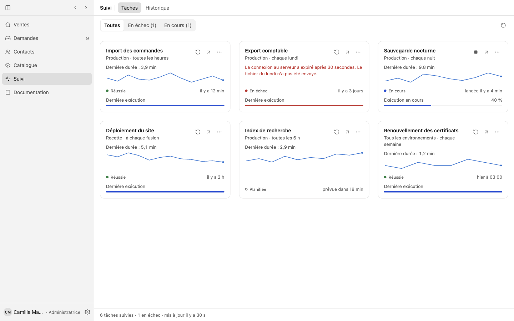

# Recette : Tableau de suivi
Statut : validé (2026-11-27, par délégation de l'utilisateur) — Version : depuis 1.27.0
Décision : D-431 ; D-423 (blocs encadrés), D-426 (relecture), D-427 (UI d'abord). Stories : « Recettes/Tableau de suivi ». Captures : [clair](TrackingBoard-clair.png), [sombre](TrackingBoard-sombre.png).



## Quand la prendre
- Quelques éléments qui tournent seuls et qu'on surveille : tâches planifiées, jobs d'intégration continue, déploiements, conteneurs, sauvegardes, synchronisations.
- Chaque élément a un état (réussi, en échec, en cours, planifié), une dernière exécution et des actions (relancer, arrêter, ouvrir le journal).
- On veut voir d'un coup d'œil ce qui ne va pas, sans ouvrir chaque élément. Une trentaine d'éléments au plus.
- Pas pour des chiffres clés et leur évolution : recette « Tableau de bord ». Pas pour une collection qu'on parcourt, qu'on cherche ou qu'on trie : recette « Liste et fiche ». Pas pour l'historique des exécutions : `ListPage` dans son onglet.

## Zones
Une zone de l'écran, une responsabilité (D-404, D-417) : chaque zone ci-dessous dit ce qu'elle porte dans cette page, avec quel composant, quand la prendre et pourquoi.

| Zone | Sa responsabilité ici | Composant | Quand, pourquoi |
|---|---|---|---|
| Onglet fixe « Tâches » | Surveiller l'état de chaque élément suivi | `Page` sur toute la largeur | L'usage de tous les jours : regarder et agir. Jamais `width="text"` : la grille prend la place. |
| Barre d'outils de la page | Le filtre d'état, à gauche ; « Actualiser », à droite | `Page` `toolbar` (`SegmentedControl` : Toutes, En échec (n), En cours (n)) ; `actions` zone `toolbar` | Le filtre vaut pour toute la grille et s'applique tout de suite. Les compteurs disent ce qui attend sans filtrer. |
| Contenu | Un bloc par élément suivi, dans un ordre stable | `PageGrid columns={3}`, `PageSection framed` | Côte à côte : on compare les états d'un regard. L'ordre ne change pas avec l'état : les blocs ne sautent pas pendant une relecture. |
| En-tête d'un bloc | Le nom de l'élément, où et quand il tourne ; ses actions | `title`, `description` (« Production · toutes les heures »), `actions` zone `section` | L'action porte sur cet élément : elle est dans son bloc. « Relancer » (ou « Arrêter » pendant une exécution) et « Ouvrir le journal » en icônes, le reste dans « … ». |
| Contenu d'un bloc | Ce qui aide à décider : la dernière erreur, ou la durée et sa tendance | `PageSection` `children` : une phrase ; `Sparkline` | Une erreur se lit en entier, en `--danger`. Sans erreur, la durée et sa petite courbe montrent une dérive. Pas de tableau ni de liste dans un bloc. |
| Pied d'un bloc | L'état, la dernière exécution, l'avancement | `PageSection` `footer` : `Badge` et date relative sur une ligne, `ProgressBar` dessous | Ce qui se compare d'un bloc à l'autre : collé en bas, aligné sur la ligne de la grille (D-423). |
| Pied de la page | Le total et la fraîcheur | `Page` `footer` | « 6 tâches suivies · 1 en échec · mis à jour il y a 30 s » : on sait que l'écran est à jour. |
| Onglet fixe « Historique » | Les exécutions passées | `ListPage` | Un autre contexte : retrouver une exécution, filtrer, trier. Un bloc y mène, filtré. |

Une grille, pas de rangée de chiffres clés au-dessus : les compteurs du filtre suffisent.

## Actions
| Action | Où | Forme |
|---|---|---|
| Filtrer par état | Barre d'outils de `Page` | `SegmentedControl`, appliqué tout de suite, compteurs dans les libellés |
| Actualiser tout | Barre d'outils de `Page`, à droite | Icône ; `Page isRefreshing` jusqu'à la réponse |
| Relancer | En-tête du bloc | Icône ; le bloc relit (`isRefreshing`) jusqu'au nouvel état |
| Arrêter (pendant une exécution) | En-tête du bloc, à la place de « Relancer » | Icône, avec confirmation |
| Ouvrir le journal | En-tête du bloc | Icône : la vue du journal (onglet ou panneau) |
| Suspendre la planification, autres | En-tête du bloc | Dans « … » |

## États
| État | Rendu |
|---|---|
| Premier chargement, liste des éléments pas encore lue | UI d'abord (D-427) : la barre d'outils tout de suite ; à la place de la grille, un seul bloc `PageSection framed title="Tâches" state="loading"`. Jamais `Page state="loading"`. |
| Liste lue, état d'un élément pas encore lu | Son bloc en `state="loading"` : titre, puis squelette ; les autres blocs s'affichent. |
| Relecture en fond (périodique) | Silencieuse : les blocs changent quand les nouvelles valeurs arrivent. Le pied de la page dit la fraîcheur. |
| « Actualiser » | `Page isRefreshing` : barre de 2 px sous la barre d'outils, tout reste affiché (D-426). |
| « Relancer » | `PageSection isRefreshing` du bloc : barre de 2 px sur le bord haut du cadre, le bloc garde ses données (D-426). Puis le pied passe à « En cours » et la barre d'avancement avance. |
| Échec de lecture d'un élément | Son bloc en `state="error"` avec `onRetry` : les autres restent. |
| Filtre sans élément | Un bloc `empty` : « Aucune tâche dans cet état », action « Voir toutes les tâches ». |
| Aucun élément suivi | Un bloc `empty` : « Aucune tâche suivie », action « Ajouter une tâche ». |

## Comportement
- Les blocs d'une ligne ont la même hauteur ; leurs pieds sont alignés (D-423). Sous 768 px de large, deux colonnes ; sous 504 px, une (D-403).
- L'ordre des blocs est celui de l'app (ordre de création, ou choisi), jamais un tri par état : un bloc ne change pas de place pendant que l'utilisateur vise une action.
- Le pied d'un bloc : `Badge` de l'état (« Réussie » `success`, « En échec » `danger`, « En cours » `info`, « Planifiée » `pending`), la date relative à droite ; `ProgressBar` : valeur pendant une exécution, pleine et sans valeur après (`danger` après un échec), absente pour une exécution planifiée.
- Une exécution en cours remplace « Relancer » par « Arrêter », avec confirmation.

## Squelette
```tsx
<Page toolbar={<SegmentedControl label="État" options={FILTRES} value={filtre} onChange={setFiltre} />}
  actions={[{ id: "actualiser", label: "Actualiser", icon: <RotateCcw />, onPress: actualiser }]}
  isRefreshing={actualisation} footer={`${taches.length} tâches suivies · ${enEchec} en échec · mis à jour ${fraicheur}`}>
  {taches === undefined ? (
    <PageSection framed title="Tâches" state="loading" />
  ) : (
    <PageGrid columns={3}>
      {taches.map((t) => (
        <PageSection key={t.id} framed title={t.nom} description={t.ou} state={t.etat ? "ready" : "loading"}
          isRefreshing={relance === t.id} actions={actionsDe(t)}
          footer={<>
            <Badge tone={TON[t.etat]}>{LIBELLE[t.etat]}</Badge> {/* et la date relative, sur la même ligne */}
            <ProgressBar label="Exécution en cours" value={t.avancement} />
          </>}>
          {t.erreur ?? <Sparkline values={t.durees} label={`Durée des ${t.durees.length} dernières exécutions`} />}
        </PageSection>
      ))}
    </PageGrid>
  )}
</Page>
```

## À éviter
- `Card` pour un élément suivi : elle n'a ni description, ni actions d'en-tête, ni pied collé en bas (D-423).
- Une pile de blocs dans une colonne de 760 px, ou un bloc seul dans un grand vide : la grille prend la largeur (D-404).
- Trier les blocs par état, ou les faire bouger à chaque relecture.
- `Page state="loading"` au premier chargement, ou des squelettes à chaque relecture (D-426, D-427).
- La barre d'avancement ou l'état dans le contenu du bloc : ils vont dans le pied, alignés d'un bloc à l'autre.
- Un tableau des exécutions dans un bloc : l'historique a son onglet.

## Décisions
D-111, D-113, D-115, D-403, D-404, D-417, D-423, D-426, D-427, D-428, D-431.
