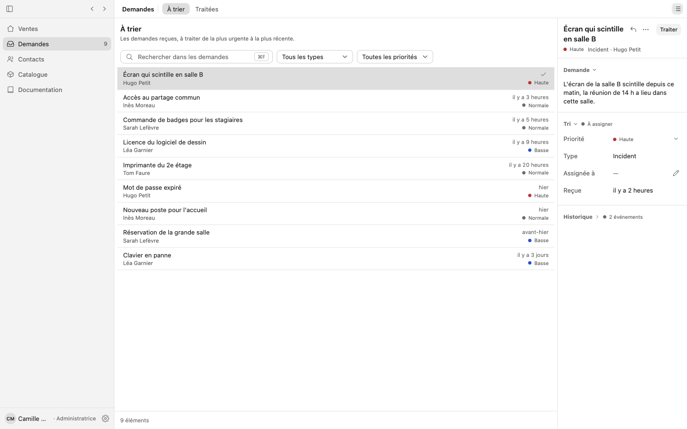

# Recette : File de tri
Statut : validé (2026-11-26, par délégation de l'utilisateur) — Version : depuis 1.21.0
Décision : D-408. Stories : « Recettes/File de tri ». Captures : [clair](TriageQueue-clair.png), [sombre](TriageQueue-sombre.png).



## Quand la prendre
- Des éléments qui arrivent et qu'on traite un par un : demandes, messages, tickets, notes de frais à valider.
- Chaque élément se lit, reçoit une décision (traiter, répondre, reporter, assigner), puis quitte la file.
- Pas pour une collection qu'on consulte sans la vider : recette « Liste et fiche ».

## Zones
| Zone | Ce qui y va | Composant |
|---|---|---|
| Barre du haut, vues | « À trier », « Traitées » | vues de l'`AppShell` (D-021) |
| Sidebar | Le nombre d'éléments à trier, sur l'entrée de la page | `count` de `Sidebar.Item` |
| `main` | La file, de la plus urgente à la plus récente ; recherche, filtres (type, priorité) | `ListPage` `layout="list"`, `advanceOnRemove` |
| Panneau de détail | L'élément sélectionné : le message, puis le tri (priorité, type, personne, date), puis l'historique replié | `Drawer` déclaratif |

## Actions
| Action | Où | Forme |
|---|---|---|
| Traiter | En-tête du panneau ; ligne de la file | Action `primary` de la zone `section` (bouton) ; icône de ligne |
| Répondre | En-tête du panneau | Icône |
| Reporter, autres décisions | En-tête du panneau | Dans « … » |
| Changer la priorité, le type | Ligne de la section « Tri » | Menu de choix (`action` de type `icon` avec `menu`) |
| Assigner | Ligne de la section « Tri » | Icône qui ouvre une saisie courte |

Libellés courts dans l'en-tête du panneau : « Traiter », pas « Marquer comme traitée » ; le panneau est étroit.

## États
| État | Rendu |
|---|---|
| File vide | `EmptyState` de `ListPage` : « Rien à trier », « Les nouvelles demandes arrivent ici. », sans action. Le panneau dit « Rien à trier. ». |
| Aucune sélection | `emptyMessage` du panneau : « Sélectionnez une demande pour la trier. » |
| Chargement, erreur | Rendus par `ListPage` et `Drawer` (`isLoading`, `hasError`, `onRetry`). |
| Élément traité | Il quitte « À trier » et passe dans « Traitées » ; le compteur de la sidebar baisse. |

## Comportement
- `advanceOnRemove` : l'élément traité quitte `rows` ; la sélection passe à celui qui le suivait à l'écran, ou au précédent s'il était le dernier (D-415). Le panneau montre aussitôt le suivant : on trie sans revenir à la liste.
- La priorité se lit d'un coup d'œil : statut de chaque ligne (`Badge`), avec le ton (`danger` pour haute).
- La date de réception est relative (« il y a 2 heures »).
- Les sections du panneau se replient ; l'historique est replié au départ (`defaultCollapsed`), son résumé dit combien d'événements.

## Squelette
```tsx
<ListPage title="À trier" rows={aTrier} columns={COLONNES} layout="list"
  item={{ title: "objet", subtitle: "demandeur", meta: "recue", status: "priorite" }}
  filters={[TYPE, PRIORITE]} selectedId={choisie} onSelect={(d) => choisir(d?.id ?? null)} advanceOnRemove
  empty={{ title: "Rien à trier", description: "Les nouvelles demandes arrivent ici." }} />

<Drawer header={{ title: d.objet, subtitle: `${type} · ${d.demandeur}`, status: PRIORITES[d.priorite],
  actions: [{ id: "traiter", label: "Traiter", icon: <Check />, primary: true, onPress: traiter }, repondre, reporter] }}
  sections={[{ id: "demande", title: "Demande", content: d.message }, { id: "tri", title: "Tri", fields: [...] },
    { id: "historique", title: "Historique", summary: "2 événements", defaultCollapsed: true, content: <List … /> }]} />
```

## À éviter
- Un bouton « Suivant » ou une sélection remise à zéro après chaque décision : `advanceOnRemove` le fait.
- Les décisions en gros boutons dans la page : elles vont dans l'en-tête du panneau.
- La file et l'élément côte à côte dans la page : l'élément va dans le panneau de détail (D-404).
- Des champs de saisie dans le panneau : une valeur se change par l'action de sa ligne.

## Décisions
D-021, D-059, D-111, D-113, D-183, D-404, D-408, D-415.
